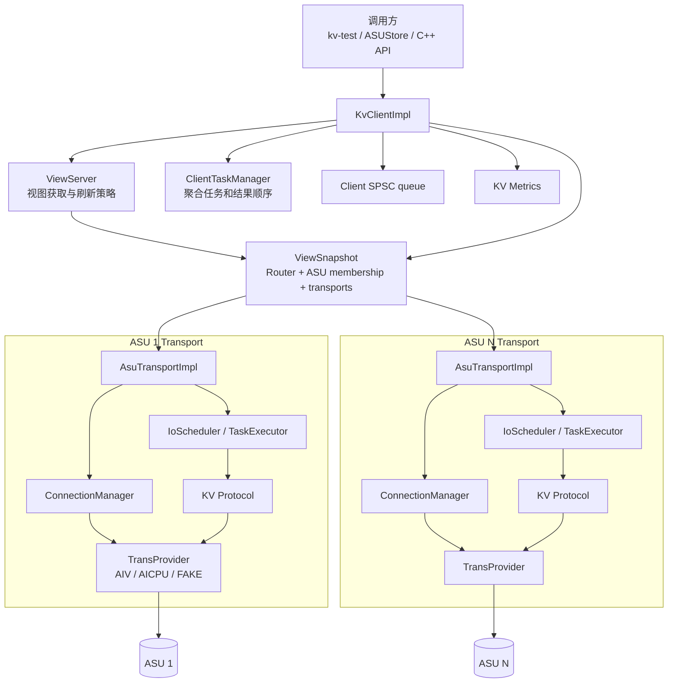
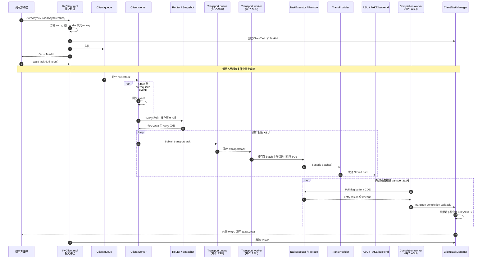
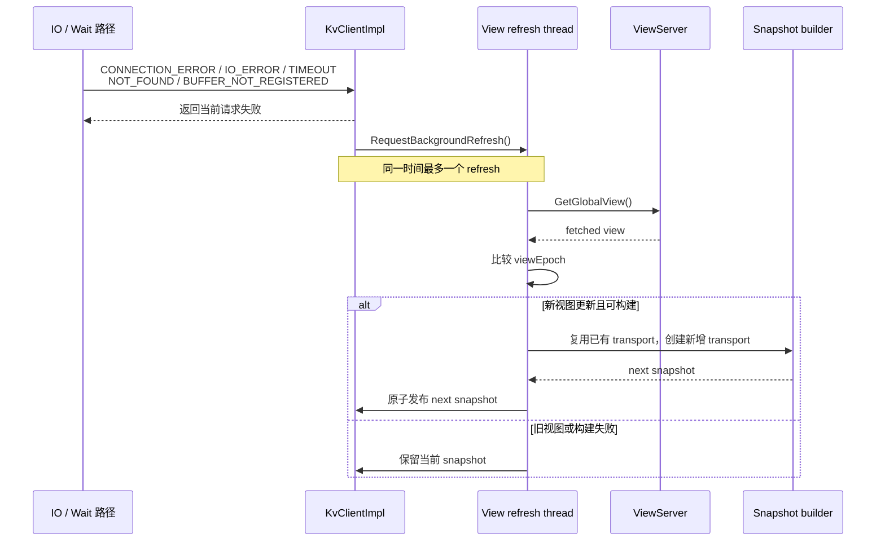
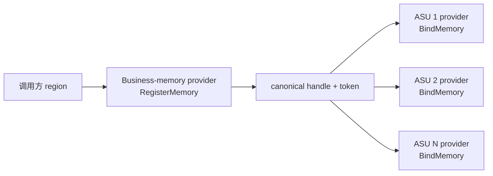

# KVClient 架构与异步请求时序

KVClient 位于调用方与多个 ASU transport 之间。它对外暴露一个任务，对内按 key 路由并拆成多个 transport task，最后把结果按原始输入顺序聚合。

## 1. 组件图

### KvClientImpl

负责公共 API、Client 任务队列、路由快照、结果聚合、业务内存注册和后台视图刷新。每个 Client 有一个 Client worker。

### ViewServer 和 ViewSnapshot

`ViewServer` 提供当前 ASU membership，并决定新视图是否应发布、哪些错误应触发刷新。

`ViewSnapshot` 是不可变的提交快照，包含 Router、ASU 列表和对应 transport。一个 Client task 从创建到完成始终持有同一 snapshot，因此刷新不会改变已提交任务的路由。

### Router

Router 把 8 字节 key 映射到 ASU ID。支持类型明确限定为 Ring Hash（`RING_HASH`）和 Maglev（`MAGLEV`）；affinity 配置可解析，但不属于本文支持范围。路由结果还保存每个 entry 在原请求中的下标，供完成时恢复顺序。

### ClientTaskManager

维护调用方看到的 TaskId，并把一个 Client task 拆成每 ASU 一个 transport task。所有已派发子任务完成后，它生成总体状态、逐 entry 状态和 QueryResult。

### AsuTransportImpl

每个 ASU 对应一个 transport。Transport 有独立执行队列、执行 worker 和 completion worker，负责子批次切分、协议打包、provider Send、完成轮询和超时。

### TransProvider

屏蔽 AIV、AICPU 和 FAKE 的差异，提供连接、发送、注册内存、绑定内存和 token 查询接口。

## 2. 线程模型

一个 KVClient 实例主要包含以下线程：

| 线程 | 数量 | 职责 |
| --- | --- | --- |
| 调用方线程 | 由业务决定 | 提交、Check、Wait、注册内存。 |
| Client worker | 1 | 等待 prerequisite event，路由、拆分并派发 transport task。 |
| Transport worker | 每个 transport 1 个 | 从 transport queue 取任务，打包并调用 provider Send。 |
| Completion worker | 每个 transport 1 个 | 轮询在途任务，处理 CQE、超时和完成回调。 |
| Connection recover worker | 每个 transport 管理 | 检测连接状态并执行恢复。 |
| View refresh thread | 最多 1 个 | 错误触发时异步获取并构建新视图。 |
| FAKE backend worker | 配置决定 | 使用 FAKE provider 时执行本地文件 IO。 |

`completion_poll_spin_limit` 只控制 completion worker 连续未发现完成时何时 `yield`，不是请求超时。

## 3. Store/Load 异步请求时序

下面的时序明确区分调用方、Client worker、Transport worker 和 Completion worker。多个 ASU 时，Transport 部分会并行发生。

关键点：

- `StoreAsync()`/`LoadAsync()` 在任务进入 Client queue 后即可返回。
- event 同步发生在 Client worker，不在调用方线程。
- 同一 Client 的路由和派发由一个 Client worker 串行执行。
- 不同 ASU 有独立 Transport worker 和 Completion worker，可以并行发送和完成。
- `Wait()` 不负责执行 IO，只等待完成通知；返回后 TaskId 被消费。

## 4. Query 时序差异

Query 与 Store/Load 使用相同的队列和线程，但没有业务数据 buffer：

1. Client worker 按 key 路由。
2. 每个 ASU 返回该分组的 `exists`。
3. ClientTaskManager 根据保存的原始下标合并结果。
4. 从原始 `exists[0]` 开始计算连续命中数 `prefixHitKeys`。

因此 `prefixHitKeys` 与 transport 完成顺序无关，只与调用方提交的 key 顺序有关。

## 5. 失败和完成聚合

当某个 transport task 派发失败时：

- 已经派发的 transport task继续执行并等待完成。
- 首个未派发 task 记录实际派发错误。
- 后续未派发 task 标记为 `CANCELED`。
- 所有可等待项结束后，Client task 总体返回 `PARTIAL_FAILED`。

Transport 完成失败不会跳过其他 ASU 的完成处理。这样调用方可以从 `entryStatus` 中获得尽可能完整的逐项结果。

## 6. 视图刷新时序

刷新只影响后续任务，当前失败请求不会在 Client 内部重试。业务重试必须由调用方决定。

## 7. 内存注册路径

Client 选择一个 business-memory provider 完成真实注册并取得 token。shared 模式下 transport 复用同一 provider；independent 模式下，Client 使用 token 在每个 transport provider 创建本地绑定。

Client 保存 canonical handle 到各 provider 本地 handle 的映射。新视图增加 provider 时，会先绑定已有 region，成功后才发布新 snapshot。

## 8. Shutdown 顺序

Shutdown 的主要顺序为：

1. 标记 Client 不再接受新任务。
2. 停止 Client worker，并处理队列中剩余任务。
3. 等待后台 view refresh 结束。
4. 按默认超时 drain Client tasks。
5. 停止当前和 retired transports。
6. 按逆序解除 provider 内存绑定。
7. 清空 snapshot、配置和注册记录。

如果业务希望可靠取得任务结果，应在 Shutdown 前主动 Wait，而不是依赖 Shutdown drain。

## 9. 多 KVNS 能力限制

当前 Init 只获取一份 GlobalView，按该视图创建 transport 和 Router，没有遍历所有 kvns-id 视图并创建 transport 并集。SQE 携带 KVNS ID 不等于支持按 KVNS ID 路由。

多 KVNS 需要调整 Init：每个 KVNS 建立独立 Router，按 ASU 身份去重创建所有视图的 transport 并集，重叠 ASU 复用 transport，并明确处理 endpoint/provider 配置冲突。刷新、内存注册绑定和关闭也必须覆盖该并集。当前不具备这一能力。

当前 EID 由用户显式写入配置文件（本地设备 EID 和远端 ASU EID）；这属于当前实现的配置方式。未来需要改为自动发现 EID，不再将 EID 写入配置文件；该自动发现能力尚未实现。

M800 路由地址二级列表和 M900 一级列表的区分、解析和选择规则仍是能力缺口，平面 endpoint 列表不等价于完成机型路由适配。
